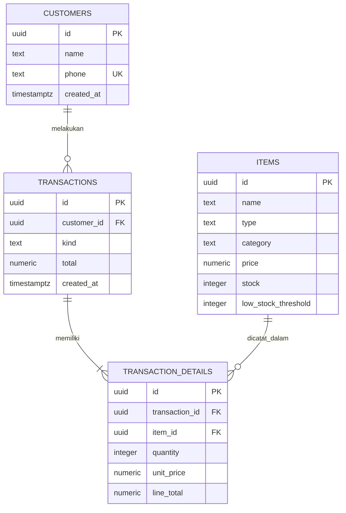

# SISTEM PERSEDIAAN PETSHOP DAN GROOMING DZAKIYA

<div align="center">

🐾 **Sistem Informasi Persediaan dan Pencatatan Transaksi Petshop & Grooming**

Aplikasi berbasis web untuk membantu pengelolaan persediaan produk, layanan grooming, data pelanggan, dan transaksi penjualan pada Petshop dan Grooming Dzakiya.

[**🌐 LIHAT DEMO APLIKASI**](https://dzakiyakode.github.io/Sistem-Persediaan-Petshop-dan-Grooming-Dzakiya-/#ringkasan)

</div>

---

## IDENTITAS MAHASISWA

| Keterangan         | Informasi                                  |
| ------------------ | ------------------------------------------ |
| **Nama**           | Dzakiya Fauziah Mufidaturrizqi             |
| **NIM**            | 12030124120004                             |
| **Mata Kuliah**    | Pengkodean dan Pemrograman / D             |
| **Dosen Pengampu** | Dr. Totok Dewayanto, S.E., M.Si., Akt., CA |
| **Program Studi**  | S1 Akuntansi                               |
| **Fakultas**       | Fakultas Ekonomika dan Bisnis              |
| **Universitas**    | Universitas Diponegoro                     |

---

## DESKRIPSI PROYEK

**Sistem Persediaan Petshop dan Grooming Dzakiya** merupakan aplikasi berbasis web yang dikembangkan untuk mendukung pengelolaan operasional petshop dan layanan perawatan hewan secara lebih terstruktur, praktis, dan terintegrasi. Sistem ini menggabungkan pencatatan persediaan produk fisik dengan pencatatan transaksi layanan grooming dalam satu aplikasi.

Aplikasi ini menggunakan HTML, CSS, dan JavaScript pada sisi frontend, serta Supabase dengan PostgreSQL sebagai basis data. Sistem dirancang untuk membantu pengelola dalam memantau ketersediaan stok, mengelola informasi pelanggan, mencatat transaksi penjualan produk maupun layanan grooming, serta menyimpan riwayat transaksi secara terstruktur.

Selain mendukung pencatatan transaksi, sistem menerapkan validasi stok dan mekanisme transaksi atomik pada basis data. Dengan mekanisme tersebut, transaksi penjualan hanya dapat diproses apabila persediaan mencukupi, sedangkan layanan grooming tidak mengurangi stok produk fisik. Harga satuan dan subtotal transaksi juga disimpan sebagai bagian dari riwayat transaksi untuk menjaga ketepatan pencatatan nilai penjualan.

Melalui pengembangan sistem ini, diharapkan proses pengelolaan persediaan dan transaksi Petshop dan Grooming Dzakiya menjadi lebih efisien, konsisten, dan mudah dipantau.

## DEMO APLIKASI

🔗 **[Dzakiya | Petshop & Grooming](https://dzakiyakode.github.io/Sistem-Persediaan-Petshop-dan-Grooming-Dzakiya-/#ringkasan)**

Klik tautan di atas untuk membuka aplikasi secara langsung melalui GitHub Pages.

---

## FITUR UTAMA

### 1. Manajemen Katalog Produk dan Layanan

* Menyimpan data produk dan layanan grooming dalam satu katalog.
* Mengelompokkan item berdasarkan jenis dan kategori.
* Menyimpan informasi nama item, harga, dan stok.
* Membedakan produk fisik (`product`) dengan layanan grooming (`service`).
* Menentukan batas minimum stok sebagai acuan kebutuhan pengisian ulang persediaan.

### 2. Manajemen Persediaan

* Mencatat jumlah persediaan produk fisik.
* Memvalidasi ketersediaan stok sebelum transaksi penjualan diproses.
* Mengurangi stok secara otomatis setelah transaksi penjualan berhasil.
* Mencegah stok berkurang apabila transaksi gagal.
* Menyediakan parameter batas minimum stok untuk membantu mengidentifikasi produk yang perlu di-restock.

**Catatan:** layanan grooming tidak memiliki persediaan fisik sehingga tidak mengurangi stok ketika transaksi layanan dicatat.

### 3. Pencatatan Transaksi Penjualan dan Grooming

* Mendukung dua jenis transaksi, yaitu penjualan produk (`sale`) dan layanan grooming (`grooming`).
* Menghubungkan transaksi dengan data pelanggan.
* Mencatat item, kuantitas, harga satuan, subtotal, dan total transaksi.
* Memvalidasi jenis item sesuai dengan jenis transaksi.
* Menyimpan riwayat transaksi beserta rincian item yang dibeli atau layanan yang digunakan.

### 4. Manajemen Data Pelanggan

* Menyimpan identitas pelanggan yang melakukan transaksi.
* Mencatat nama dan nomor telepon pelanggan.
* Menghubungkan data pelanggan dengan riwayat transaksi.
* Mendukung pencarian atau pencocokan pelanggan berdasarkan nomor telepon maupun nama, sesuai mekanisme pada basis data.

### 5. Validasi dan Integritas Data

* Memastikan jumlah item yang ditransaksikan valid.
* Mencegah penjualan produk ketika stok tidak mencukupi.
* Mencegah pencatatan jenis item yang tidak sesuai dengan transaksi.
* Menyimpan harga satuan saat transaksi berlangsung agar riwayat harga tetap akurat meskipun harga katalog berubah.
* Menggunakan mekanisme *rollback* apabila terjadi kegagalan dalam proses transaksi.

### 6. Basis Data Terintegrasi

* Menggunakan Supabase PostgreSQL sebagai basis data utama.
* Menggunakan relasi antartabel untuk menjaga keterkaitan data.
* Menggunakan *stored procedure* `create_transaction` untuk memproses transaksi secara atomik.
* Menggunakan indeks pada kolom tertentu untuk membantu mempercepat pengambilan data transaksi.

---

## TEKNOLOGI YANG DIGUNAKAN

| Teknologi        | Fungsi                                                                  |
| ---------------- | ----------------------------------------------------------------------- |
| **HTML5**        | Menyusun struktur halaman aplikasi.                                     |
| **CSS3**         | Mengatur tampilan, tata letak, dan desain antarmuka.                    |
| **JavaScript**   | Menangani interaksi pengguna dan logika frontend.                       |
| **Supabase**     | Menyediakan layanan backend dan koneksi ke basis data.                  |
| **PostgreSQL**   | Menyimpan data pelanggan, katalog, transaksi, dan rincian transaksi.    |
| **GitHub Pages** | Menyediakan akses demo aplikasi melalui web.                            |
| **SQL**          | Membuat struktur tabel, relasi, validasi, indeks, dan fungsi transaksi. |

---

## STRUKTUR FOLDER PROYEK

```text
Sistem-Persediaan-Petshop-dan-Grooming-Dzakiya/
│
├── frontend/
│   ├── html/
│   │   └── index.html
│   │
│   ├── css/
│   │   └── style.css
│   │
│   └── js/
│       └── app.js
│
├── backend/
│   ├── app.js
│   └── schema.sql
│
├── docs/
│   └── skema-database.md
│
└── README.md
```

**Keterangan:**

* `frontend/html/` berisi struktur halaman aplikasi.
* `frontend/css/` berisi pengaturan tampilan aplikasi.
* `frontend/js/` berisi logika interaksi dan pengelolaan data pada frontend.
* `backend/app.js` merupakan opsi server HTTP dan API berbasis Node.js.
* `backend/schema.sql` berisi skema PostgreSQL, fungsi transaksi, indeks, dan data awal katalog.
* `docs/skema-database.md` berisi dokumentasi struktur basis data dan relasi antartabel.
* `README.md` berisi dokumentasi utama proyek.

*Catatan: sesuaikan nama dan lokasi file pada dokumentasi ini apabila struktur repository aktual berbeda.*

---

## ENTITY RELATIONSHIP DIAGRAM (ERD)

Sistem menggunakan **empat entitas utama** yang saling terhubung untuk mendukung pengelolaan pelanggan, item, dan transaksi.



### Penjelasan Entitas

| Entitas               | Fungsi                                                                                       |
| --------------------- | -------------------------------------------------------------------------------------------- |
| `customers`           | Menyimpan identitas pelanggan.                                                               |
| `items`               | Menyimpan katalog produk dan layanan grooming.                                               |
| `transactions`        | Menyimpan informasi utama transaksi, pelanggan, jenis transaksi, total, dan waktu transaksi. |
| `transaction_details` | Menyimpan rincian item, kuantitas, harga satuan, dan subtotal setiap item dalam transaksi.   |

Hubungan antartabel menggunakan *Primary Key* (PK) dan *Foreign Key* (FK). Tabel `transaction_details` berfungsi sebagai penghubung antara transaksi dan item yang dicatat.

---

## ALUR KERJA TRANSAKSI

Proses pencatatan transaksi menggunakan fungsi PostgreSQL `create_transaction` dengan tahapan berikut:

1. **Validasi input** — memeriksa nama pelanggan, jenis transaksi, dan daftar item.
2. **Pencocokan pelanggan** — mencari pelanggan yang sudah terdaftar atau membuat data baru apabila diperlukan.
3. **Pembuatan transaksi** — menyimpan data utama transaksi.
4. **Validasi item dan stok** — memeriksa jenis item serta kecukupan stok untuk penjualan produk.
5. **Pencatatan rincian** — menyimpan kuantitas, harga satuan, dan subtotal.
6. **Pembaruan stok** — mengurangi persediaan produk fisik apabila penjualan berhasil; layanan grooming tidak mengurangi stok.
7. **Penyelesaian transaksi** — menghitung total transaksi dan menyimpan hasilnya.

### Mekanisme Transaksi Atomik

Sistem menggunakan transaksi atomik untuk menjaga konsistensi data. Apabila salah satu tahapan gagal, perubahan dalam transaksi tersebut dibatalkan melalui *rollback*. Penguncian baris menggunakan `FOR UPDATE` juga membantu mencegah dua transaksi bersamaan menggunakan stok yang sama secara tidak konsisten.

---

## CONTOH DATA KATALOG AWAL

Berdasarkan dokumentasi skema basis data, berikut contoh data katalog awal yang disediakan.

| Nama Item                  | Jenis   | Kategori     |     Harga |
| -------------------------- | ------- | ------------ | --------: |
| Makanan Kucing Premium 1kg | Produk  | Makanan      |  Rp85.000 |
| Shampoo Kucing Anti Kutu   | Produk  | Perawatan    |  Rp45.000 |
| Pasir Kucing 10L           | Produk  | Perlengkapan |  Rp65.000 |
| Grooming Lengkap Kucing    | Layanan | Grooming     | Rp120.000 |
| Grooming Lengkap Anjing    | Layanan | Grooming     | Rp150.000 |

Data tersebut merupakan contoh katalog awal pada skema database dan bukan pernyataan mengenai harga aktual yang berlaku pada demo.

---

## CARA MENJALANKAN APLIKASI

### A. Menggunakan Demo Online

1. Buka tautan [Dzakiya | Petshop & Grooming](https://dzakiyakode.github.io/Sistem-Persediaan-Petshop-dan-Grooming-Dzakiya-/#ringkasan).
2. Tunggu hingga halaman aplikasi selesai dimuat.
3. Gunakan antarmuka yang tersedia untuk mencoba fitur aplikasi.

### B. Menjalankan Secara Lokal

1. Unduh atau *clone* repository dari GitHub.
2. Buka proyek menggunakan editor kode seperti Visual Studio Code.
3. Siapkan proyek Supabase dan pastikan konfigurasi koneksi frontend sesuai dengan proyek yang digunakan.
4. Buka **SQL Editor** pada Supabase Dashboard.
5. Jalankan isi file `backend/schema.sql` untuk membuat tabel, relasi, fungsi transaksi, indeks, dan data katalog awal.
6. Buka file HTML utama melalui browser atau gunakan server lokal untuk menyajikan frontend.
7. Pastikan konfigurasi database dan koneksi aplikasi sudah benar sebelum mencoba transaksi.

**Informasi tambahan:** berdasarkan konfigurasi proyek, frontend dapat berkomunikasi langsung dengan Supabase REST API tanpa harus menjalankan server Node.js terpisah. `backend/app.js` merupakan opsi backend tambahan, bukan syarat untuk metode frontend statis tersebut.

---

## KEAMANAN DATABASE

Sistem perlu memperhatikan keamanan akses data pelanggan, persediaan, dan transaksi. Berdasarkan audit pada dokumentasi skema versi 3.0, konfigurasi yang dijelaskan masih menonaktifkan *Row Level Security* (RLS) pada empat tabel dan memberikan hak akses baca/tulis kepada role `anon`.

Konfigurasi tersebut memiliki risiko karena pihak yang mengetahui URL proyek dan publishable key dapat mengakses data sesuai hak akses yang diberikan. Oleh karena itu, konfigurasi tersebut **belum layak digunakan untuk menyimpan data produksi yang sensitif tanpa perbaikan keamanan**.

Rekomendasi pengembangan berikutnya meliputi:

* Mengaktifkan RLS pada seluruh tabel.
* Membatasi izin baca, tambah, ubah, dan hapus berdasarkan kebutuhan.
* Menerapkan autentikasi untuk pengguna seperti admin dan kasir.
* Membuat kebijakan akses berdasarkan peran pengguna.
* Memastikan fungsi transaksi memiliki konfigurasi hak akses yang aman.
* Tidak menempatkan `service_role` key atau kredensial rahasia di frontend.

---

## TUJUAN PENGEMBANGAN

Pengembangan Sistem Persediaan Petshop dan Grooming Dzakiya bertujuan untuk:

1. Membantu pencatatan persediaan produk secara lebih terstruktur.
2. Mempermudah pencatatan transaksi penjualan produk dan layanan grooming.
3. Menjaga konsistensi data melalui validasi dan mekanisme transaksi pada basis data.
4. Mengintegrasikan data pelanggan, katalog item, dan riwayat transaksi.
5. Menerapkan konsep pemrograman web dan basis data relasional dalam studi kasus operasional usaha petshop.

## PENGEMBANGAN SELANJUTNYA

Beberapa pengembangan yang dapat dipertimbangkan untuk menyempurnakan sistem meliputi:

* Dashboard ringkasan penjualan dan persediaan.
* Laporan transaksi harian dan bulanan.
* Peringatan stok minimum dan rekomendasi restock.
* Fitur pencarian dan penyaringan data.
* Pengelolaan akun admin dan kasir dengan autentikasi.
* Ekspor laporan transaksi ke Excel atau PDF.
* Penguatan keamanan basis data melalui RLS dan kebijakan akses berbasis peran.

---

## PENUTUP

Sistem Persediaan Petshop dan Grooming Dzakiya merupakan implementasi aplikasi berbasis web yang mengintegrasikan pengelolaan persediaan, pencatatan pelanggan, dan transaksi penjualan maupun layanan grooming. Proyek ini menerapkan HTML, CSS, JavaScript, Supabase, dan PostgreSQL untuk membangun sistem yang terstruktur serta menjaga konsistensi data transaksi.

Melalui proyek ini, konsep pengkodean, pemrograman web, dan basis data relasional diterapkan pada kebutuhan operasional usaha secara nyata.

<div align="center">

**Dibuat oleh Dzakiya Fauziah Mufidaturrizqi**

Program Studi S1 Akuntansi
Fakultas Ekonomika dan Bisnis
Universitas Diponegoro

🐾 *Petshop & Grooming Dzakiya*

[**Buka Demo Aplikasi**](https://dzakiyakode.github.io/Sistem-Persediaan-Petshop-dan-Grooming-Dzakiya-/#ringkasan)

</div>

